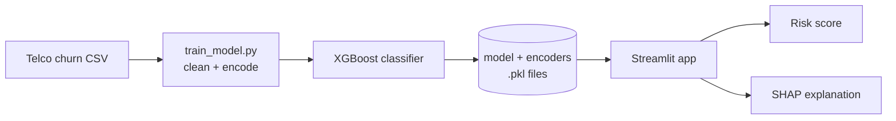

# Customer Churn Prediction

A machine learning app that predicts which telecom customers are likely to cancel, and explains why. An XGBoost model trained on 7,000+ customers is served in a Streamlit dashboard, with SHAP showing which factors drive each prediction.

**Stack:** Python · pandas · scikit-learn · XGBoost · SHAP · Streamlit

> Part of my portfolio at **[devanshi4.github.io](https://devanshi4.github.io)**

---

## The problem

Keeping a customer is cheaper than winning a new one, but a retention team can only call so many people. They need to know who is at risk and why: a high monthly bill calls for a different offer than a month-to-month contract. A risk score with no reason attached is hard to act on.

## How it works



1. **Train.** `train_model.py` cleans the IBM Telco dataset, encodes the categorical columns, trains XGBoost on an 80/20 split, and saves the model, the encoders and the column order.
2. **Score.** In the app, a user sets a customer profile (contract, tenure, services, charges) and gets a churn probability.
3. **Explain.** SHAP ranks the features that most influenced that customer's score.

## Design decisions

- **XGBoost for tabular data.** Gradient-boosted trees are a strong default for mixed numeric and categorical columns, and they work directly with SHAP's fast tree explainer.
- **Explanations, not just scores.** Each prediction comes with its top drivers, so the retention team knows what to offer.
- **Training and serving share the same encoders.** The encoders and column order are saved with the model and reused in the app, so a value like "Month-to-month" becomes the same number in both.
- **Scenario testing built in.** Changing one field in the sidebar (for example, a one-year contract) re-scores the customer immediately.

## Results

- Test accuracy of about **79%** on a held-out 20% of customers.
- The strongest churn drivers were **contract type** (month-to-month churns most), **tenure** and **paying by electronic check**.

## Run it locally

You need Python 3.9+ and the [IBM Telco Customer Churn dataset](https://www.kaggle.com/datasets/blastchar/telco-customer-churn) saved as `WA_Fn-UseC_-Telco-Customer-Churn.csv` in the repo folder.

1. Install dependencies:

   ```bash
   pip install -r requirements.txt
   ```

2. Train the model:

   ```bash
   python train_model.py
   ```

3. Start the dashboard:

   ```bash
   streamlit run app.py
   ```

## Project structure

```
├── train_model.py     # Clean, encode, train and save the model
├── app.py             # Streamlit dashboard with SHAP explanations
└── requirements.txt
```

## Status and next steps

- Report precision, recall and ROC-AUC alongside accuracy. Only about a quarter of customers churn, so accuracy alone overstates performance.
- Tune the decision threshold for the retention team's budget, not the default 0.5.
- Replace label encoding with one-hot encoding for columns that have no natural order.
- Deploy the app to Streamlit Community Cloud.

---

Built by **Devanshi Pandya** · [Portfolio](https://devanshi4.github.io) · [LinkedIn](https://www.linkedin.com/in/devanshi4/)
